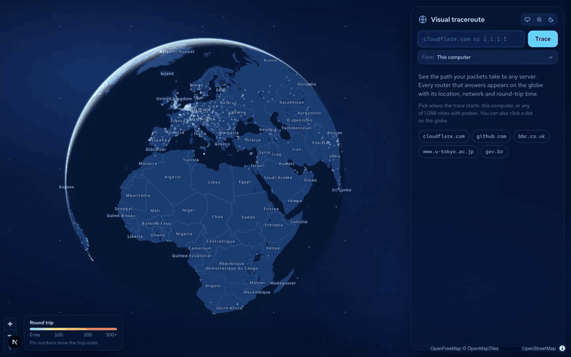
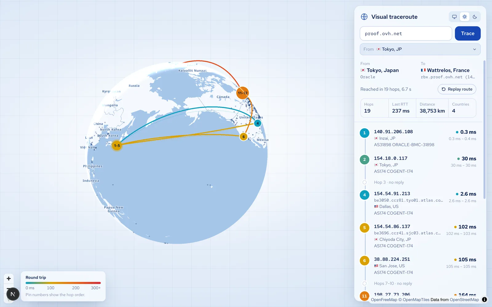
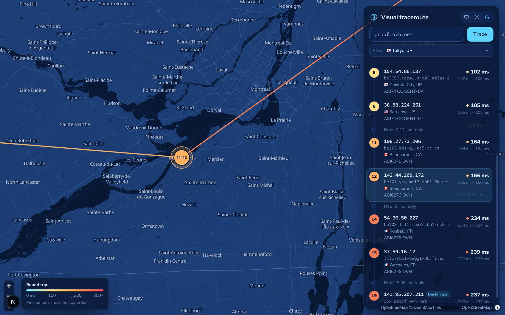

# Visual traceroute

Trace the network path to any host and follow every hop on a 3D globe that turns into a street map as you zoom in.

**Live:** https://traceroute.facundotenuta.dev



<table>
  <tr>
    <td></td>
    <td></td>
  </tr>
</table>

## How it works

A browser cannot send packets with a limited TTL, so the trace never runs in the visitor's browser. It runs on a server or on a measurement probe, and the browser only draws what comes back.

1. **Run the trace.** Either the system `traceroute` on the machine running the app, or a [Globalping](https://globalping.io) probe in any of ~1,100 cities. Both produce traceroute text, so one parser handles both.
2. **Stream the hops.** `/api/trace` sends Server-Sent Events: each hop is sent as soon as it is parsed, and sent again whenever it gains reverse DNS or a location.
3. **Draw the route.** MapLibre renders the globe and the vector map; deck.gl draws the 3D arcs on top. The camera stays top-down and follows the line as it grows; tilting is left to the visitor.

## Design decisions

- **Every trace is a fresh measurement.** Results are never cached, because the tool exists to measure the network as it is now. Abuse is limited instead: each visitor may start 10 remote traces per hour, at most 3 traces run at once, and a trace stops after 150 seconds.
- **Arcs follow the sphere.** Repeated or back-and-forth segments are fanned out symmetrically by rotating them around the great-circle normal, not shifted in longitude/latitude, so they stay clean near the poles.
- **One colour per segment.** Each line takes the round-trip time of the hop it reaches, on a cyan-to-red scale. A gradient inside one line would suggest a latency change that was never measured.
- **Untrusted input never reaches a shell.** The target is validated as a hostname or IPv4 address and passed as an argument array. Remote origins are accepted only as ids from the probe catalogue, so no free text reaches the Globalping API.
- **The API token stays on the server.** `GLOBALPING_TOKEN` is read in one server-only module and never sent to the browser.
- **Honest geography.** Hop locations come from IP registries, so a backbone router can appear where its address is registered rather than where it is (see Limits). The map labels the Islas Malvinas and the other South Atlantic islands by their Argentine names and draws disputed borders dashed.

## Stack

Next.js 16 (App Router, route handlers streaming SSE), React 19, TypeScript, MapLibre GL 5 (globe projection, [OpenFreeMap](https://openfreemap.org) tiles), deck.gl 9, Vitest (251 tests). Deployed on Vercel.

## Trace origins

Pick where the trace starts:

- **This computer**: the server runs the system `traceroute` and streams each hop as it answers (local or self-hosted installs).
- **Any of ~1,100 cities**: the trace runs on a [Globalping](https://globalping.io) probe in that city (optionally on one network there), then the route draws hop by hop. This mode only needs HTTP, so it works on Vercel. By default the app suggests the probe city nearest to the visitor.

Every hop is enriched with reverse DNS and an approximate location from [ip-api.com](https://ip-api.com). The panel shows per-hop IP, hostname, location, ASN/ISP, min/avg/max round-trip time and packet loss.

## Run it

```bash
pnpm install
pnpm dev
```

Open http://localhost:3000.

Locally both modes are available. Serverless hosts cannot run traceroute, so there only remote locations are offered.

## Deploy on Vercel

1. Import the repository in Vercel (framework: Next.js) or run `vercel` from the project folder.
2. Set these environment variables (Project → Settings → Environment Variables):
   - `TRACE_LOCAL=0`: there is no traceroute binary, so only remote locations are offered.
   - `TRUST_PROXY=1`: Vercel overwrites `X-Forwarded-For`, so the per-visitor limit can trust it.
   - `GLOBALPING_TOKEN` (recommended): without it, every visitor shares Globalping's anonymous limit of 250 tests per hour for the server's IP.
3. Deploy. The visitor's nearest probe city comes from Vercel's `x-vercel-ip-latitude`/`x-vercel-ip-longitude` headers.

Before using it commercially, note that ip-api's free endpoint is for non-commercial use: set `IPAPI_KEY` (Pro) or swap in another geolocation source.

## Requirements

- Node.js 22+ and pnpm
- `traceroute` on the `PATH` for local traces (preinstalled on macOS; `apt install traceroute` on Debian/Ubuntu)
- Internet access to `ip-api.com` (geolocation), `tiles.openfreemap.org` (map tiles) and `api.globalping.io` (remote traces). No API keys needed.

## Configuration

Copy `.env.example` to `.env` and fill in what you need; every variable is optional. `.env` is git-ignored, and none of these values is sent to the browser except `NEXT_PUBLIC_GA_IDS`, which is public by design.

| Variable | Effect |
| --- | --- |
| `IPAPI_KEY` | Optional ip-api Pro key. When set, lookups use the HTTPS endpoint `pro.ip-api.com` with a local budget of 1,000 per minute; without it they use the free HTTP endpoint. |
| `GLOBALPING_TOKEN` | Optional Globalping API token for remote traces; raises the hourly limit, which is otherwise shared by every visitor of a deployment. |
| `REMOTE_TRACES_PER_HOUR` | Remote traces each visitor may start per sliding hour (default `10`). Protects the Globalping quota every visitor shares. |
| `TRACE_LOCAL` | Set to `0` to turn off traces from this computer (they are offered automatically when `traceroute` is found on the `PATH`). |
| `TRUST_PROXY` | Set to `1` only behind a proxy that overwrites `X-Forwarded-For`. Enables the per-client limit; otherwise forwarding headers are ignored because any caller could forge them. |
| `NEXT_PUBLIC_GA_IDS` | Comma-separated Google Analytics 4 measurement ids, read at build time (see Analytics). Unset: no analytics script and no events. |

## Analytics

Production sends Google Analytics 4 events to the ids in `NEXT_PUBLIC_GA_IDS` (comma-separated; `traceroute.facundotenuta.dev` uses the global `facundotenuta.dev` property, `G-4RGE1D3764`). The variable is read at build time, so changing it needs a new build.

- **Without it** (local development, previews) the page loads no Google script and every event is a no-op.
- **With it** `gtag.js` loads once after the page is interactive and each id gets one `config`. Page views, scrolls and outbound clicks come from GA4 enhanced measurement; no manual `page_view` is sent. The cookie stays on the registrable domain (`cookie_domain: auto`), so a visitor keeps one client id across `*.facundotenuta.dev`.
- **No personal data.** A typed hostname is sent; a typed IP address is reported only as `target_type: "ip"`, and other free text only as `"invalid"`. No hop, origin or destination addresses are sent. Strings are capped at 100 characters.

All custom events go through `track()` in `src/lib/client/analytics.ts`. Register the params as custom dimensions (text) or metrics (numbers) in the GA property to report on them.

| Event | When | Params |
| --- | --- | --- |
| `trace_start` | A trace is requested (Trace button, Enter, or a sample host) | `origin_type` (`local`/`remote`), `origin_city`, `origin_country`, `asn` (remote only, when a network was picked), `target_type` (`hostname`/`ip`/`invalid`), `target_host` (hostnames only) |
| `trace_complete` | Once, when the stream sends `done` | `origin_type`, `origin_city`, `hops`, `reached`, `distance_km` (rounded), `countries`, `duration_ms` |
| `trace_error` | `/api/trace` refuses, the stream sends `error`, or the connection drops | `status` (HTTP status, `0` when the request never got one), `reason`: `validation` (400), `rate_limit` (429, concurrency), `quota` (429 with `retry-after`, hourly remote limit), `unavailable` (503), `http` (other status), `stream` (stream `error` event), `network` (fetch failed or the stream closed early) |
| `origin_select` | A location, "This computer", "Near you" or a network is picked in the "From" list | `origin_type`, `origin_city`, `origin_country`, `asn` |
| `probe_dot_click` | A probe city dot is clicked on the globe | `city`, `country` |
| `sample_target_click` | A sample host chip is clicked (followed by `trace_start`) | `target` |
| `hop_select` | A hop row or a hop pin on the map is selected | `hop` |
| `replay_route` | "Replay route" is clicked | — |
| `theme_change` | The theme switch changes value | `theme` (`system`/`light`/`dark`) |

The site has no language switch, calls to action or sectioned pages, so the shared `language_change`, `cta_click` and `section_view` events do not apply here.

## Scripts

| Command | What it does |
| --- | --- |
| `pnpm dev` | Start the dev server |
| `pnpm build` / `pnpm start` | Production build and server |
| `pnpm test` | Unit tests (vitest) |
| `pnpm lint` | ESLint |

## Limits

- IPv4 targets and hostnames only for now.
- ip-api's free tier allows 45 lookups per minute. Without a key the app keeps itself under 40, pauses when ip-api reports the quota is used up, and caches results in memory (up to 2,000 addresses for 24 hours; unknown addresses for 5 minutes). Hops beyond the budget show no location.
- Geolocation of backbone routers and anycast addresses (such as `1.1.1.1`) is approximate: it reflects where the address is registered, not always where the router is.
- Each visitor may start 10 remote traces per hour (`REMOTE_TRACES_PER_HOUR`); local traces don't count. On a serverless host each instance keeps its own count, so the cap is approximate. Results are never cached: every trace is a fresh measurement.
- At most 3 traces run at the same time. With `TRUST_PROXY=1`, each client (by `X-Forwarded-For`) may run at most 2 of them. A trace is stopped after 150 seconds and ends with the hops found so far.
- Private hops (your own network) are shown by IP only: no reverse DNS or location, so internal hostnames are not exposed.
- Numeric shorthand such as `0x7f.1` is rejected; use a full IPv4 address.

## API

`GET /api/probes` lists the cities you can trace from, the one nearest the caller, and whether local traces are available.

`GET /api/trace?target=<host-or-ipv4>[&from=<city id>[&asn=<network>]]` returns `text/event-stream`. Each `data:` frame is a JSON event: `start`, `origin`, `destination`, `hop` (sent again whenever the hop gains more detail), then `done` or `error`. Invalid targets get `400` and busy limits get `429`, both with `{ "error": "..." }`.
